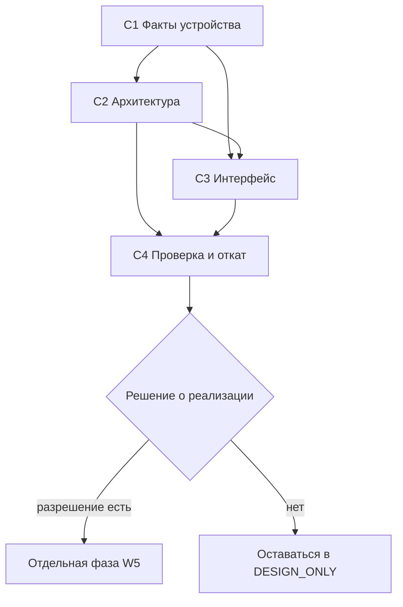

# SYNTHESIS

Сводка клеток C1–C4 в единое решение. Документ описывает связи и ограничения, а не результаты проверок.

## MECE-границы

| Клетка | Отвечает на | Включает | Не включает |
| --- | --- | --- | --- |
| **C1 Device Audit** | Что за устройство? | Идентификация, props, root/overlay capability, launcher, OTA | Архитектуру модуля и дизайн UI |
| **C2 Module Arch** | Как сделать обратимо? | Доставка, точки входа, состояние, idempotency, rollback | Вопрос «что именно красиво» и прогон тестов |
| **C3 UI Feasibility** | Что можно показать? | Карта элементов, RRO/лаунчер/API, ограничения Android 14 | Механизм установки и тестовые прогоны |
| **C4 Validation Plan** | Как доказать и вернуть? | Тесты, стоп-критерии, Recovery runbook | Сбор фактов о железе и визуальный дизайн |

**Правило разрешения споров:** факт об устройстве → C1; способ записи/отката → C2; видимый пользователю элемент → C3; способ проверки или восстановления → C4.

## Зависимости

## Цепочка решения

1. **C1** снимает неопределённость: есть ли root-менеджер, `cmd overlay`, нужные target-пакеты.
2. **C2** выбирает минимальный systemless-механизм и подписывает контракт «включил → выключил → сток».
3. **C3** фильтрует визуальные идеи через контракт C2: всё, что требует системного APK или смены настроек, отбрасывается.
4. **C4** превращает оставшееся в проверяемую матрицу и план возврата.
5. Решение о реализации принимается только после шлюза G4 и отдельного разрешения.

## Целевой контракт системы

| Свойство | Требование |
| --- | --- |
| Расположение | Только каталог модуля root-менеджера; никогда `/system`, `/vendor`, `/boot` |
| Запись в разделы | Запрещена |
| Системные APK | Не заменяются, не удаляются, не переподписываются |
| Настройки безопасности | Не изменяются; A11y/device admin/SELinux/Verified Boot не трогаются |
| Состояние | Хранятся только собственные метаданные модуля и хеши своих артефактов |
| Откат | Отключение модуля + удаление его каталога + перезагрузка возвращают сток |
| Идемпотентность | Повторный запуск не создаёт дубликатов и не меняет результат |
| Обратная совместимость | OTA не должен приводить к «полуотключённому» состоянию |

## Реестр рисков

| Риск | Источник | Митигация | Владелец | Статус |
| --- | --- | --- | --- | --- |
| Данные пользователя приняты за проверенные | C1 | Статусы в `DEVICE_PROFILE.md` | C1 | OPEN |
| Root-менеджер отсутствует | C1 | Переход к без-root варианту или остановка | C1/C2 | OPEN |
| RRO недоступен или конфликтует | C1/C3 | Снижение до палитры/лаунчера либо отказ | C3 | OPEN |
| Конфликт с чужим модулем | C2 | Проверка владельцев overlay до активации | C2 | OPEN |
| OTA сбрасывает модуль | C2/C4 | Post-OTA проверка и повторная установка только после разрешения | C4 | OPEN |
| Случайное изменение настроек безопасности | Все | Явный запрет и стоп-критерий в C4 | C4 | OPEN |
| Утечка персональных данных в логах | C4 | Маскирование, запрет полных дампов | C4 | OPEN |

## Открытые вопросы

1. Какой root-менеджер фактически установлен и его версия?
2. Какие минимальные resource-ключи доступны в целях C3?
3. Нужен ли «Balanced» как отдельный профиль с пониженной интенсивностью эффектов?
4. Допустимо ли использовать пользовательское приложение вместо системных overlay?
5. Кто является владельцем шторки уведомлений и экрана блокировки на этой сборке?

## Критерии готовности

- [ ] Каждый факт в профиле имеет статус достоверности.
- [ ] Каждая клетка имеет критерии готовности и не содержит выдуманных результатов.
- [ ] Архитектура имеет описанный откат без прошивки.
- [ ] Визуальные функции разделены на достижимые/недостижимые с обоснованием.
- [ ] Матрица тестов содержит стоп-критерии и шаги восстановления.
- [ ] В репозитории нет секретов, APK, дампов и фиктивных отчётов.
