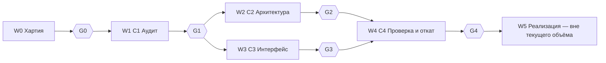

# WAVE — волны работ и шлюзы

Волны задают порядок, но не результаты. Переход на следующую волну возможен только при наличии фактических данных предыдущей.

## W0 — Хартия и ограничения

**Статус:** `DONE` (только документация; к устройству не применялось).

- Зафиксировать данные устройства как непроверенные.
- Определить MECE-границы клеток.
- Запретить изменения устройства и выдуманные отчёты.
- Настроить `.gitignore` против секретов и бинарников.

**Выход:** этот репозиторий, `docs/DEVICE_PROFILE.md`, `.mece/SYNTHESIS.md`, четыре `TASK.md`.

**Шлюз G0:** все файлы созданы; ни одного `REPORT.md`; ни одного APK/дампа/ключа.

## W1 — Аудит устройства (C1)

**Статус:** `NOT_STARTED`.

- Подтвердить identity-поля read-only командами.
- Уточнить root/overlay/launcher/OTA без изменения настроек.
- Присвоить каждому полю статус из легенды профиля.

**Выход:** заполненный статусный блок в `C1/TASK.md` и обновлённый `docs/DEVICE_PROFILE.md`.

**Шлюз G1:** нет полей `UNKNOWN`, критичных для выбора механизма; каждый `OBSERVED_READ_ONLY` имеет команду и дату.

## W2 — Архитектура модуля (C2)

**Статус:** `BLOCKED` до G1.

- Выбрать механизм systemless-доставки под фактический root-менеджер.
- Описать контракт обратимости, состояние и обработку конфликтов.
- Спроектировать dry-run и аварийный откат.

**Выход:** архитектурное решение и спецификация отката в `C2/TASK.md`.

**Шлюз G2:** каждый механизм имеет способ отключения; ни один шаг не пишет в разделы и не меняет настройки безопасности.

## W3 — Реализуемость интерфейса (C3)

**Статус:** `BLOCKED` до G1 и G2.

- Сформировать язык «Balanced Hyper»: палитра, типографика, отступы, радиусы.
- Разнести возможности по механизмам: RRO, лаунчер, пользовательское приложение, недостижимо.
- Отсечь функции, требующие замены системных APK или прав доступа.

**Выход:** ранжированный список элементов с механизмами и рисками в `C3/TASK.md`.

**Шлюз G3:** ни одна одобренная функция не требует изменения системных APK, загрузчика или настроек безопасности.

## W4 — Проверка и восстановление (C4)

**Статус:** `BLOCKED` до G2 и G3.

- Построить матрицу тестов от статики до read-only smoke.
- Определить критерии остановки и признаки регресса.
- Подготовить runbook восстановления как план, не как выполненный откат.

**Выход:** матрица тестов и runbook в `C4/TASK.md`.

**Шлюз G4:** для каждого теста есть ожидаемый результат и действие при провале; откат не требует прошивки.

## W5 — Реализация

**Статус:** `OUT_OF_SCOPE`.

Не начинается без отдельной явной задачи и разрешения на работу с устройством.

## Правила waves

- Волна не закрывается «по умолчанию»: нужен явный статус и ссылка на данные.
- Если проверка невозможна, волна получает `BLOCKED`, а не `DONE`.
- `REPORT.md` не создаётся; результаты фиксируются в статусных блоках `TASK.md`.
- Любая находка, меняющая профиль устройства, возвращает работу в W1.
